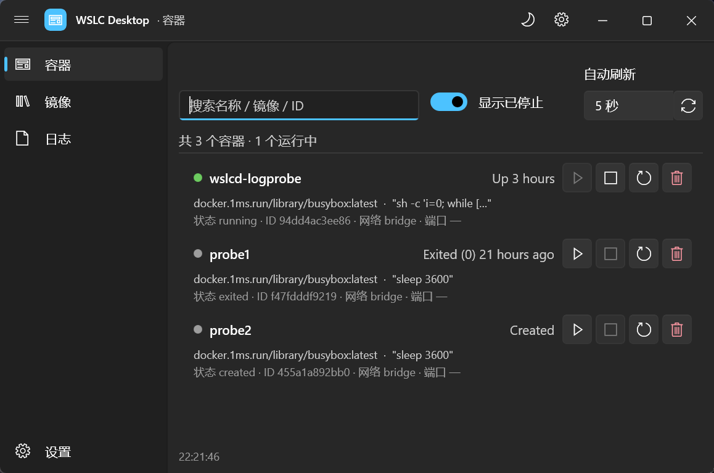

# wsld

管理 Windows WSL 容器(`wslc` CLI)的 WinUI 3 桌面应用:容器与镜像的列表、启动/停止/重启/删除、
日志、拉取镜像与实时进度、`wslc run` 命令编排,加上主题与多语言设置——把命令行里那些事做成
能点、能看、能复制的界面。



技术栈:WinUI 3(Windows App SDK 2.5,.NET 9,非打包模式)+ 独立的 `wsld.Core`
业务层(进程调用、解析、ViewModel,与 UI 解耦、可单测)。

## 功能

每个功能都有一份 spec(是什么 / 为什么 / 预期行为)和对应的单元测试。

| 编号 | 功能 | 状态 | 规格 |
|---|---|---|---|
| 001 | 容器列表 | 已实现 | [docs/specs/001-container-list.md](docs/specs/001-container-list.md) |
| 002 | 容器生命周期操作(启动/停止/重启/删除) | 已实现 | [docs/specs/002-container-actions.md](docs/specs/002-container-actions.md) |
| 003 | 镜像列表与应用导航 | 已实现 | [docs/specs/003-images.md](docs/specs/003-images.md) |
| 004 | 镜像操作(拉取 / 删除) | 已实现 | [docs/specs/004-image-actions.md](docs/specs/004-image-actions.md) |
| 005 | 容器日志(尾部行数 / 时间戳 / 实时跟随) | 已实现 | [docs/specs/005-container-logs.md](docs/specs/005-container-logs.md) |
| 006 | 进入容器(执行命令) | 规划 | — |
| 007 | 资源统计 stats | 规划 | — |
| 008 | 网络与卷 | 规划 | — |
| 009 | 设置页(主题 / 语言 i18n)与界面改版 | 已实现 | [docs/specs/009-settings-i18n-theme.md](docs/specs/009-settings-i18n-theme.md) |
| 010 | 镜像加速(registry mirror)配置与拉取改名 | 已实现 | [docs/specs/010-registry-mirror.md](docs/specs/010-registry-mirror.md) |
| 011 | 拉取镜像的实时进度(伪终端屏幕 + 分层汇总) | 已实现 | [docs/specs/011-pull-progress.md](docs/specs/011-pull-progress.md) |
| 012 | `wslc run` 命令可视化编排(生成 / 复制 / 就地执行 / 粘贴读回) | 已实现 | [docs/specs/012-run-command-builder.md](docs/specs/012-run-command-builder.md) |

## 开始使用

- **只要用起来**:拿 `wsld-Setup-<版本>-x64.exe` 安装包双击安装,客户机不需要预装 .NET
  或 Windows App SDK;实际使用仍需本机已装 WSL 3。出包与分发见
  [docs/release-packaging.md](docs/release-packaging.md)。
- **要改代码**:环境要求、构建/运行/测试命令、工程结构见
  [docs/development.md](docs/development.md)。

```powershell
just dev    # 编译并启动(需要 just;没有就用 dotnet build + dotnet run,见开发指南)
just test   # 单元测试
```

## 文档

| 文档 | 讲什么 |
|---|---|
| [docs/development.md](docs/development.md) | 环境、命令、工程结构、单元与端到端测试 |
| [docs/release-packaging.md](docs/release-packaging.md) | 打交付给客户安装包:方案、图标、代码签名/SmartScreen、常见问题 |
| [docs/specs/](docs/specs/) | 各功能的规格与预期行为 |
| [docs/dev-notes.md](docs/dev-notes.md) | 会反复踩到、网上查不到的坑(WinUI 3 / 构建 / 布局) |
